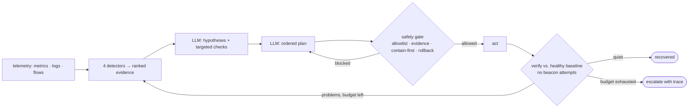
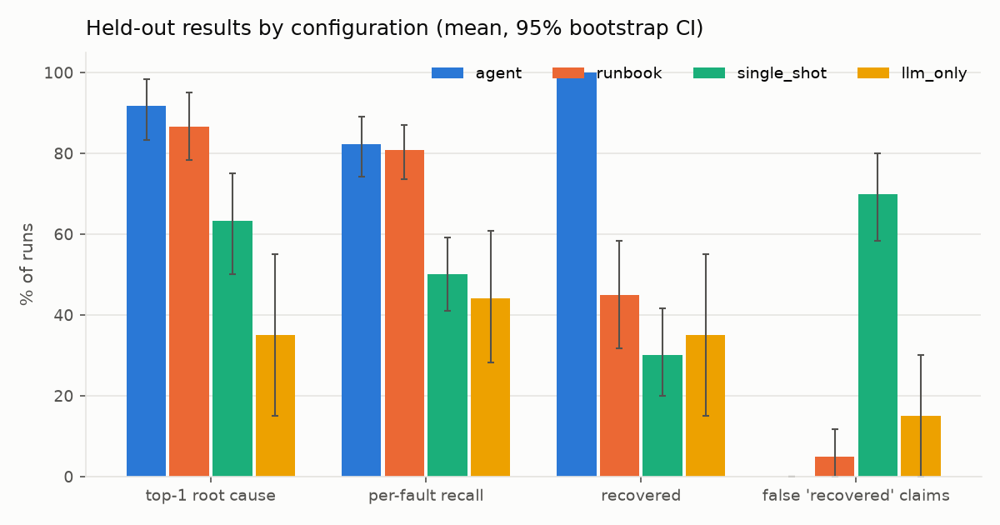
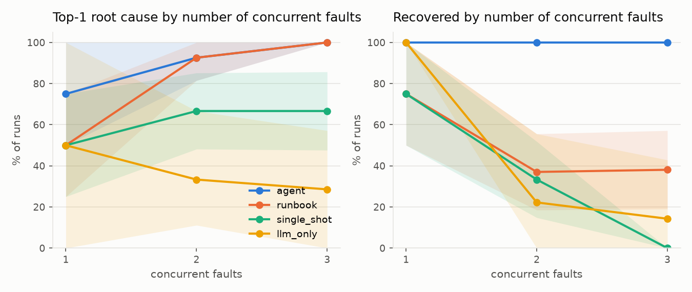
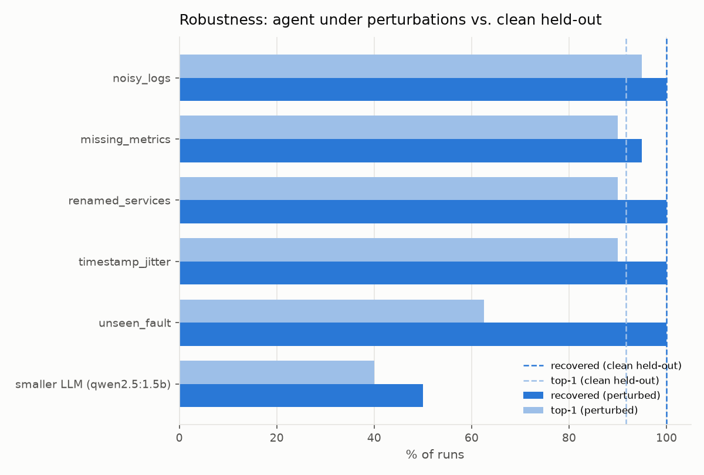
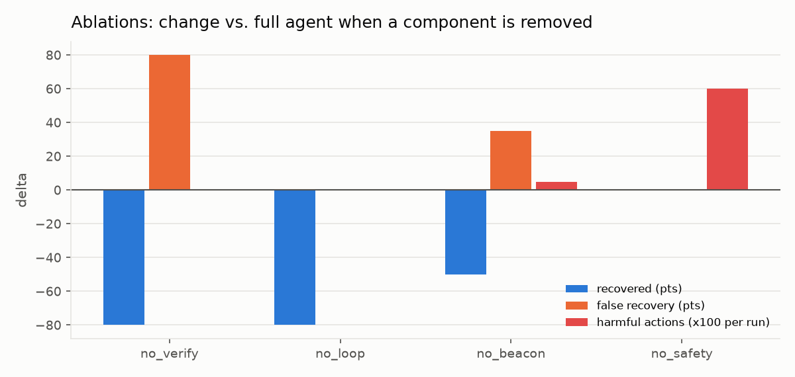
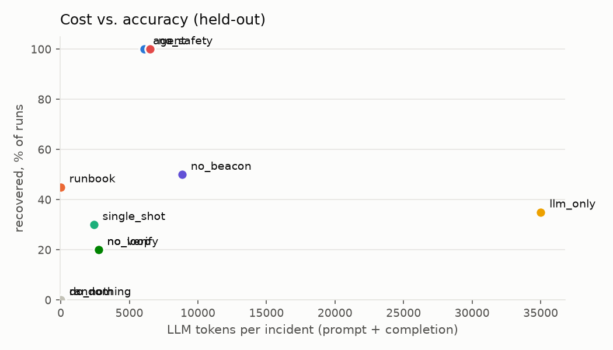
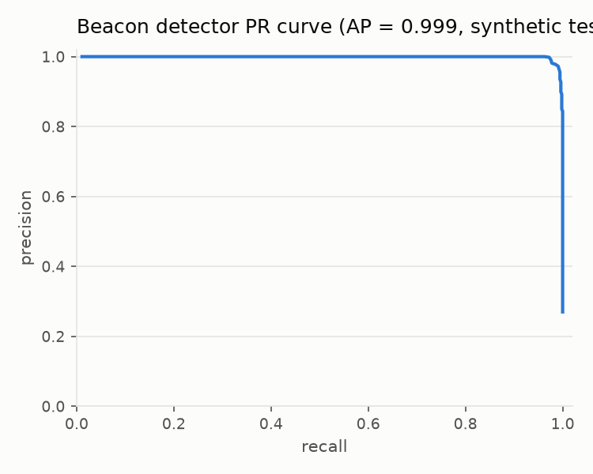

<p align="center">
  <picture>
    <source media="(prefers-color-scheme: dark)" srcset="assets/logo/sentinel-rx-logo-dark-transparent.svg">
    
  </picture>
</p>

# Sentinel-RX — security-aware agentic recovery of a failing system

[](https://github.com/AbdulAlharbi/sentinel-rx/actions/workflows/ci.yml)
[](https://AbdulAlharbi.github.io/sentinel-rx/)


**Humain Hackathon, Challenge 1: Agentic Recovery of a Failing System.**
**Site:** https://AbdulAlharbi.github.io/sentinel-rx/ ·
**6-page brief:** [`docs/technical_report/sentinel_rx_brief.pdf`](docs/technical_report/sentinel_rx_brief.pdf) ·
**full technical report (27 pages):** [`docs/technical_report/sentinel_rx_technical_report.pdf`](docs/technical_report/sentinel_rx_technical_report.pdf) ·
**research paper (literature review):** [`docs/literature_review.pdf`](docs/literature_review.pdf) ·
**slides (11):** [`docs/slides/sentinel_rx_slides.pdf`](docs/slides/sentinel_rx_slides.pdf) ([PowerPoint](docs/slides/sentinel_rx_slides.pptx))

Sentinel-RX is an agent that **identifies, diagnoses, recovers and verifies the recovery** of a
failing enterprise system when several faults are active at once and a security compromise may be
hiding inside the outage — plus a reproducible benchmark that proves it on incidents the agent has
never seen. Four cheap deterministic detectors compress telemetry into a ranked evidence list; a
local 7B model (`qwen2.5:7b` via Ollama) reasons over it in a budgeted loop; a **safety layer**
enforces an allowlist, *contain-before-restart* and transactional rollback; a **verification gate**
lets the agent say "recovered" only when post-action telemetry matches the healthy baseline and no
beacon attempt remains. Everything was developed and evaluated on one laptop, no GPU, no cloud, no
Docker, and every number replays from a committed cache with no model installed.



## Why it matters

* **Locally.** Banks, utilities, telecoms and government services operate under data-residency
  constraints and with scarce SRE/SOC staff. Sentinel-RX runs entirely on-premise with an open 7B
  model: no telemetry leaves the building, and the agent multiplies the people already on call by
  handling diagnosis and the safe first response, escalating with a full trace when it cannot
  verify recovery. It degrades safely: a 1.5B model recovers fewer incidents but still makes 0 %
  false claims and 0 harmful actions.
* **Globally.** Published incident-recovery agents resolve roughly 11 % of realistic tasks
  (ITBench, OpenRCA), every benchmark injects one accidental fault per scenario, and none tests a
  compromise hiding inside an outage. Restarting a beaconing host destroys evidence and re-infects
  it; Sentinel-RX detects the beacon among health checks and update polls and contains before it
  restarts.
* **Research gap.** The [literature review](docs/literature_review.pdf) ends with five gaps; each
  maps to a metric this benchmark reports: **G1** concurrent faults (recovery flat at 100 % from 1
  to 3 faults), **G2** security inside ops incidents (100 % isolated-before-restart), **G3** false
  "recovered" claims (0 % vs 70 % for a single-shot LLM), **G4** agent cost (6 103 tokens/incident
  vs 35 018 for the raw-telemetry twin), **G5** robustness (95–100 % recovery under four perturbations;
  an unseen fault type is not named but is localized and recovered).

## The challenge, line by line

The challenge asks for an agent that can *investigate potential problems, analyze available
information such as logs and system metrics, identify likely causes, recommend or carry out
corrective actions, and verify that the system has recovered successfully*, where *multiple issues
occur at once*. Where each clause is met, and the held-out number that proves it (20 scenarios × 3 seeds):

| Challenge clause | Where it is met | Evidence |
|---|---|---|
| investigate potential problems | Observe step runs four detectors over the last 900 s; the LLM requests up to 3 targeted checks per iteration (`agent/loop.py`, `_run_check`) | 2.2 iterations, 4.6 LLM calls per incident |
| analyze logs and system metrics | robust z-scores on 8 metrics per service, log-template signatures, flow-timing features (`agent/detectors/`) | detector-only runbook already reaches top-1 87 % |
| identify likely causes | ranked hypotheses with confidence; the dependency ranker separates cause from symptom (`agent/detectors/ranker.py`) | top-1 92 % [83, 98], per-fault recall 82 % |
| recommend or carry out corrective actions | ordered plan from an 8-action allowlist through the safety layer (`agent/safety.py`); dry-run mode (`build_agent(..., dry_run=True)`) recommends without acting | recovered 100 %, harmful 0.00/run, action precision 81 % |
| verify that the system has recovered | verification gate vs the remembered healthy baseline (`agent/detectors/evidence.py::verify`); every claim is scored against hidden ground truth | false "recovered" 0 % (single-shot LLM: 70 %) |
| multiple issues at once | 1–3 concurrent faults per scenario, security faults hidden inside ops faults | recovered 100 % at 1, 2 and 3 faults; runbook 75 / 37 / 38 % |
| free choice of environment | deterministic simulator for the benchmark, five real local processes for the demo, one `Env` interface | same agent, byte-identical, on both |

## Headline results (held-out)

20 held-out scenarios whose fault combinations, type multisets and seeds never appear in dev,
× 3 seed offsets = 60 runs per configuration (`llm_only`: 1 seed, 20 runs). Mean with 95 %
bootstrap CI; generated by `make report` into `results/summary.md`.

| config | top-1 | per-fault recall | recovered | false "recovered" | harmful / run | action precision | LLM calls | tokens | n |
|---|---|---|---|---|---|---|---|---|---|
| **agent** | **92% [83, 98]** | **82% [74, 89]** | **100% [100, 100]** | **0% [0, 0]** | **0.00** | **81% [74, 88]** | 4.6 | 6103 | 60 |
| runbook | 87% [78, 95] | 81% [74, 87] | 45% [32, 58] | 5% [0, 12] | 0.00 | 74% [68, 80] | 0 | 0 | 60 |
| single_shot | 63% [50, 75] | 50% [41, 59] | 30% [20, 42] | 70% [58, 80] | 0.27 [0.15, 0.38] | 37% [30, 43] | 1.0 | 2421 | 60 |
| llm_only | 35% [15, 55] | 44% [28, 61] | 35% [15, 55] | 15% [0, 30] | 0.55 [0.15, 1.05] | 25% [13, 39] | 18.4 | 35018 | 20 |
| do_nothing | 0% | 0% | 0% | 0% | 0.00 | n/a | 0 | 0 | 60 |
| random | 0% | 0% | 0% | 10% [3, 18] | 3.45 [2.92, 3.98] | 5% [4, 7] | 0 | 0 | 60 |

Recovered / top-1 by number of concurrent faults: agent 100/75 %, 100/93 %, 100/100 %;
runbook 75/50 %, 37/93 %, 38/100 %; single_shot 75/50 %, 33/67 %, 0/67 %; llm_only 100/50 %,
22/33 %, 14/29 %. Top-3 is 95 % for agent and runbook, 78 % single_shot, 60 % llm_only.

| | |
|---|---|
|  |  |
|  |  |
|  |  |

**Reading the table.** The agent recovers every held-out run with no false claim and no harmful
action. The runbook diagnoses nearly as well (its thresholds are the fault definitions) but recovers
45 %: it cannot order containment before a restart and treats symptoms as causes. The single-shot
LLM claims success in 70 % of runs while recovering 30 %. The LLM-only loop (same loop, raw
telemetry instead of detectors) recovers 35 % at 5.7× the tokens: the detectors carry the result.
The sanity floors recover nothing. The agent's weak spot is single-fault top-1 (75 %): type
confusions whose fix coincides (cache latency labelled `cache_failure`, fixed by a restart), scored
as misses on purpose.

## Judging Criteria → evidence

Details and file-level pointers in [`docs/JUDGING.md`](docs/JUDGING.md).

| Criterion | Evidence |
|---|---|
| Task Performance | table above: 20 unseen scenarios × 3 seeds; split guard `bench/runner.py:201`; every held-out run logged in `results/heldout_runs.log` |
| Robustness & Adaptation | recovery 95–100 % under noisy logs, missing metrics, renamed services, timestamp jitter; an unseen fault type is never named but its service is localized (94 %) and all 8 runs recover; 1.5B model keeps 0 % false claims; same agent on simulator and live processes |
| Evaluation & Iteration | `docs/RESULTS.md`: v0→v3 with before/after numbers and a mid-development scorer audit; do_nothing/random sanity floors; 4 ablations; 109 tests; CI replays every committed held-out result and diffs it |
| Technical Judgment & Creativity | hybrid detectors + LLM measured against its raw-telemetry twin; beacon RandomForest on scale-invariant timing features; contain-before-restart; transactional rollback; verification gate with a known-beacon rule; `docs/DESIGN.md` |
| Engineering Quality | one `make` target per step, pinned deps, ruff-clean typed modules (all but the report generator under 400 lines), one `Env` interface, content-addressed LLM cache, one branch per phase merged `--no-ff` |
| Communication | this README, the [site](https://AbdulAlharbi.github.io/sentinel-rx/), the [brief](docs/technical_report/sentinel_rx_brief.pdf), the [full report](docs/technical_report/sentinel_rx_technical_report.pdf), the [literature review](docs/literature_review.pdf), the [slides](docs/slides/sentinel_rx_slides.pdf), DESIGN / RESULTS / LIMITATIONS, an incident replay viewer |

## Design decisions

| Requirement | Design decision | Why | Proof |
|---|---|---|---|
| Identify | Observe step runs four deterministic detectors and hands the LLM a per-service ranked evidence list, never raw telemetry | 4 000 flows + 2 000 log lines do not fit a 7B context; ranked evidence does (1 157 prompt tokens per call, measured) | `agent/detectors/evidence.py:71` (`to_prompt`), `tests/test_detectors.py::test_evidence_is_compact_and_quiet_after_recovery` |
| Diagnose | LLM returns ranked hypotheses + up to 3 targeted checks (strict JSON, one auto-repair); dependency ranker discounts symptoms explained by an unhealthy dependency | separates cause from victim, the main failure of threshold runbooks | `agent/detectors/ranker.py:38`, `agent/loop.py:75` (`_json_call`), `tests/test_detectors.py::test_ranker_prefers_downstream_cause_over_upstream_symptom` |
| Recover | Ordered plan from an 8-action allowlist, executed through the safety layer; history of applied actions and remaining problems fed back; repeated plans are re-asked once | small models repeat themselves; the guard halved LLM calls (docs/RESULTS.md v0→v1) | `agent/loop.py` (repeated-plan guard), `agent/prompts.py` |
| Verify | Recovery may only be claimed when `Evidence.problems()` is empty: post-action telemetry vs the remembered healthy baseline, no beacon attempt, every service up | gap G3: an agent must not grade its own work | `agent/detectors/evidence.py:185` (`verify`), `:134` (`problems`), `tests/test_detectors.py::test_verify_fails_while_fault_persists` |
| Concurrent faults | Scenarios carry 1–3 faults on distinct services; hypotheses accumulate across iterations; scorer reports per-fault recall | gap G1 | `scenarios/generate.py:88`, `bench/score.py:35`, `tests/test_agent.py::test_loop_recovers_three_faults_with_safety_reordering` |
| Security-aware ordering | Beacon detector (timing features + destination knowledge); safety layer reorders containment first and blocks a restart of a beaconing host until contained; restart-before-containment is harmful and re-infects | gap G2 | `agent/detectors/beacon.py:114`, `agent/safety.py:49` (`screen`), `faults/security.py:50`, `tests/test_sim.py::test_restart_before_containment_is_harmful_and_reinfects` |
| No false recovery claims | Contained implants keep emitting *blocked* attempts; beacon pairs flagged during the incident are "known" and any un-blocked flow on them fails verification | otherwise "contained" and "eradicated" are indistinguishable | `faults/security.py` (`blocked=True` flows), `agent/detectors/evidence.py:182`, `tests/test_detectors.py::test_verify_is_not_fooled_by_containment_alone` |
| Safety allowlist + rollback | Allowlist, evidence-gated containment, dry-run, health measured before/after each action with undo on a drop > 0.15 | collateral damage is a real failure mode (random baseline: 3.45 harmful actions/run) | `agent/safety.py:22` (`REGRESSION_DROP`), `:104` (`execute`), `env/base.py:61` (`undo_action`), `tests/test_agent.py::test_safety_rolls_back_regressions` |
| Held-out discipline | Disjoint combinations, type multisets and seeds; runner refuses non-dev splits without `--final` and logs every held-out run | criterion 1 | `scenarios/generate.py`, `bench/runner.py:201` (`guard_heldout`), `tests/test_scenarios.py::test_heldout_is_disjoint_from_dev`, `tests/test_runner.py::test_heldout_requires_final` |
| Reproducibility (replay cache) | Every LLM call cached by hash(model, system, prompt) in `cache/` (committed); `--replay` forbids live calls | the benchmark re-runs with no LLM; CI runs `make smoke` from the cache | `agent/llm.py:97` (`complete`), `:26` (`ReplayMissError`), `tests/test_agent.py::test_llm_cache_record_and_replay` |
| Cost awareness | Two LLM calls per iteration, compact prompts, tokens + latency logged per call and per run | gap G4 | `agent/llm.py` (`Usage`), `docs/figures/cost-vs-accuracy.png` |
| Health that cannot hide a sick service | observable health = ½·mean + ½·min of per-service health | with a plain mean one degraded service stayed above the 0.9 bar (scorer audit) | `env/base.py` (`combine_health`), `docs/RESULTS.md` "Scorer audit" |

Trade-offs, alternatives and the mid-development audit are written up in [`docs/DESIGN.md`](docs/DESIGN.md).

## Quick start

Requirements: Python 3.12, `make`, and for recording runs an Ollama server at `localhost:11434`
with `qwen2.5:7b` (and `qwen2.5:1.5b` for the small-model run). Replay targets need no model.

```bash
make setup          # venv, pinned deps, scenario generation, beacon detector training (~1 min)
make test           # 109 tests, no LLM needed
make smoke          # 5 dev scenarios from the replay cache, no LLM (< 60 s); CI adds regression floors
make demo-video     # ~1 min narrated tour: replays the recorded live run, re-checks the held-out runs (no LLM)
make demo-live      # 5 real local processes + 3 concurrent faults + the agent (needs Ollama)
make bench-heldout  # held-out agent + baselines, 3 seeds, --final (needs Ollama, ~2 h)
make bench-perturb  # perturbation sets + the 1.5B-model run (needs Ollama, ~2 h)
make ablate         # no_verify, no_loop, no_beacon, no_safety (needs Ollama, ~40 min)
make report         # results/summary.md, docs/figures/*.png, site/data.json
make all-final      # test + bench-heldout + bench-perturb + ablate + report
python -m http.server -d site 8000     # the site, locally
```

`make smoke` (recorded output):

```text
[agent] 1/5 dev_1f_00 s0 top1=1 rec=1 false_rec=0 harm=0 llm=2
[agent] 2/5 dev_1f_01 s0 top1=1 rec=1 false_rec=0 harm=0 llm=2
[agent] 3/5 dev_1f_02 s0 top1=1 rec=1 false_rec=0 harm=0 llm=2
[agent] 4/5 dev_1f_03 s0 top1=0 rec=1 false_rec=0 harm=0 llm=2
[agent] 5/5 dev_1f_04 s0 top1=1 rec=1 false_rec=0 harm=0 llm=2
== dev / agent: n=5 top1=0.80 recall=0.80 recovered=1.00 false_rec=0.00 harmful=0.00 -> 20261030T034744Z_dev_agent_smoke.json
smoke gate ok (20261030T034744Z_dev_agent_smoke.json): recovered=1.00, top1=0.80, false_recovery=0.00, harmful_actions=0.00
```

`make demo-live` (real processes, live model; abridged from `results/demo_live_console.txt`):

```text
[21:58:17] INJECTING three concurrent faults: memory_leak -> api · db_conn_exhaustion -> db · c2_beacon -> worker
[21:59:02] Incident in progress: health = 0.10
--- iteration 0 ---  plan: scale_connections(api), restart_service(worker), restart_service(api)
  safety: restart_service(worker) -> blocked  beacon hypothesis open: contain (block_egress/isolate) before restart
  verify after 18s: ['health 0.10 < 0.9', ..., 'beacon worker->203.0.113.47 p=0.82 blocked=0%']
--- iteration 1 ---  plan: scale_connections(db), restart_service(api)
  verify after 19s: ['worker.queue_depth up (0 -> 431)', 'beacon worker->203.0.113.47 p=0.88 blocked=0%']
--- iteration 2 ---  plan: block_egress(worker), restart_service(worker)
  verify after 15s: RECOVERED
GROUND TRUTH from the live system: active faults = none; restart-before-containment = 0; final health = 1.00
```

## Configuration

| Knob | Where | Default | Effect |
|---|---|---|---|
| `MODEL`, `SEEDS` | `make` variables (`make bench-heldout MODEL=qwen2.5:1.5b SEEDS=1`) | `qwen2.5:7b`, `3` | model name passed to Ollama; seed offsets per scenario |
| `OLLAMA_HOST` | environment | `http://localhost:11434` | Ollama endpoint used by `agent/llm.py` |
| `--split` | `python -m bench.runner` | `dev` | `dev`, `heldout`, `perturbations`, or `perturbations/<name>`; non-dev splits require `--final` |
| `--config` | runner | `agent` | comma-separated: `agent, runbook, single_shot, llm_only, do_nothing, random, no_verify, no_loop, no_beacon, no_safety` |
| `--seeds`, `--budget`, `--workers` | runner | `1`, `8`, `2` | seed offsets per scenario; loop iterations; parallel processes (keep ≤ 4 on a laptop) |
| `--replay` | runner, `env.live.demo` | off | never call the model; a cache miss is an error |
| `--limit`, `--tag` | runner | none | run only the first N scenarios; label the result file |
| `--baseline-s`, `--incident-s`, `--out` | `env.live.demo` | `35`, `45`, `results/demo_live_trace.json` | demo timing and trace path |
| `python -m bench.rescore <file>...` | | | re-score saved traces with the current scorer (writes `*_rescored.json`) |
| `python -m scenarios.generate` | | | regenerate the committed YAML (deterministic) |
| `python -m agent.detectors.beacon_train` | | | retrain the beacon RandomForest and rewrite `models/` |

## Repository layout and how the pieces connect

```text
scenarios/   YAML scenarios (dev/, heldout/, perturbations/) + generate.py (split guards) + schema.py
faults/      fault library: ops.py (7 types), security.py (c2_beacon, credential_stuffing, held-out dns_failure), base.py, registry.py
env/         base.py (Env interface, health), types.py (telemetry types, 8-action allowlist), perturb.py (observation wrappers)
  sim/       world.py (hidden state, dependency propagation), telemetry.py, sim_env.py (SimEnv, ground truth)
  live/      service.py (real http.server process), faults.py (in-process injection), sinkhole.py, live_env.py (LiveEnv), demo.py
agent/       loop.py (MAPE-K loop), safety.py, llm.py (Ollama + cache), prompts.py, schema.py, trace.py, raw.py, runbook.py, baselines.py
  detectors/ metrics.py (robust z), logs.py (templates), ranker.py (dependency-aware), beacon.py + beacon_train.py (RandomForest), evidence.py (builder + verifier)
bench/       runner.py (held-out guard, run log), configs.py (agent/baselines/ablations), score.py (all metrics), aggregate.py (bootstrap CIs), rescore.py, report.py, smoke_gate.py
models/      beacon_rf.joblib + beacon_metrics.json
cache/       committed LLM responses keyed by content hash (record/replay)
results/     per-run JSON, traces/, summary.md, heldout_runs.log, demo_live_console.txt + trace
docs/        DESIGN.md, RESULTS.md (dev iteration log + scorer audit), LIMITATIONS.md, JUDGING.md, figures/, literature_review.pdf, technical_report/ (brief + full report, .tex + .pdf), slides/ (deck, .pptx + .pdf)
site/        static site (HUMAIN/PIF palette): impact, Judging Criteria, results, figures, replay viewer, reports; data.json from make report; logo/ (copies the site serves)
assets/logo/ logo masters: icon (600×600), shield mark, wide logo for dark / light backgrounds, each as SVG + PNG
tests/       109 tests;  .github/workflows/  ci.yml (lint, tests, replay smoke, floors, full replay check) and pages.yml (deploys site/)
```

Data flow: `scenarios/` define faults → `env/sim` (or `env/live`) injects them and exposes telemetry
through `env/base.Env` → `agent/detectors` build evidence → `agent/loop` asks the model, screens the
plan through `agent/safety`, verifies through `agent/detectors/evidence` → `bench/runner` records a
trace, `bench/score` grades it against hidden ground truth, `bench/aggregate` adds CIs →
`bench/report` writes `results/summary.md`, `docs/figures/` and `site/data.json`. Every LLM call
passes through `agent/llm.py` and its cache, so the whole chain replays offline.

## Evaluation methodology

* **Splits.** dev 30 scenarios (10/12/8 for 1/2/3 faults), held-out 20 (4/9/7) with disjoint
  (type@target) combinations, disjoint type multisets for multi-fault scenarios and a disjoint seed
  range; `dns_failure` appears only in `perturbations/unseen_fault` (8 scenarios).
  `tests/test_scenarios.py` checks the committed YAML; the runner refuses non-dev splits without
  `--final` and logs every such run with its git revision.
* **Perturbations** (`env/perturb.py`): noisy logs (30 % dropped, 80 % noise lines incl. spurious
  ERRORs), missing metrics (a third of series), renamed services, timestamp jitter (Gaussian, σ = 2 s),
  unseen fault type; plus a smaller model.
* **Baselines**: `runbook` (static rules, including a naive "unknown egress → block" rule so it is
  not strawmanned on security), `single_shot`, `llm_only` (full loop, raw telemetry, LLM-judged
  verification), `do_nothing` and `random` (sanity floors: any scenario they recover is a broken check).
* **Ablations**: `no_verify`, `no_loop`, `no_beacon`, `no_safety`.
* **Metrics** (`bench/score.py`): top-1/top-3 root cause (service + type; a hit on any injected
  fault, so it gets easier as faults stack), per-fault recall (every fault must be found),
  recovered (hidden ground truth: all faults resolved, all services up, health ≥ 0.9 for 2 ticks),
  false recovery (claimed ∧ ¬recovered), harmful actions (restart before containment; containment
  of an uncompromised host), unnecessary actions (applied − effective), action precision, rolled-back
  actions, isolated-before-restart, LLM calls, tokens, wall-clock. 95 % percentile bootstrap over
  (scenario × seed) runs, 2000 resamples.
* **Scorer audit.** Mid-development the recovery metric was challenged; tests now prove no fault
  clears on its own or via the wrong target, two lenient spots were fixed, and v0–v2 were re-scored
  from saved traces (v0/v1 were not harmless: 0.27 / 0.23 wrong containments per run). Pre-audit
  numbers are kept, labelled, in `docs/RESULTS.md`.

## Robustness and ablations

| perturbation (agent, 1 seed) | top-1 | recovered | false "recovered" | harmful / run | n |
|---|---|---|---|---|---|
| noisy_logs | 95% | 100% | 0% | 0.00 | 20 |
| missing_metrics | 90% | 95% | 0% | 0.00 | 20 |
| renamed_services | 90% | 100% | 0% | 0.00 | 20 |
| timestamp_jitter | 90% | 100% | 0% | 0.00 | 20 |
| unseen_fault (dns_failure) | 62% | 100% | 0% | 0.00 | 8 |
| smaller LLM (qwen2.5:1.5b) | 40% | 50% | 0% | 0.00 | 20 |

| ablation (1 seed, delta vs full agent on the same seed) | top-1 | recovered | false "recovered" | harmful / run | LLM calls |
|---|---|---|---|---|---|
| no_verify | 80% (−10) | 20% (−80) | 80% (+80) | 0.00 | 2.0 |
| no_loop | 80% (−10) | 20% (−80) | 0% | 0.00 | 2.0 |
| no_beacon | 85% (−5) | 50% (−50) | 35% (+35) | 0.05 (+0.05) | 6.2 |
| no_safety | 90% (0) | 100% (0) | 0% | 0.60 (+0.60) | 4.8 |

Each component protects a different metric: without verification the same actions end in a false
claim 80 % of the time; without the loop only one plan is ever tried; without the beacon detector
half the runs fail and no security scenario is recovered; without the safety layer recovery is
unchanged but 0.60 harmful actions per run appear. The detectors are relative (recent vs baseline)
and scale-invariant, which is why degraded or renamed telemetry costs little. One-seed caveat:
these deltas are directional (`docs/LIMITATIONS.md`).

## Testing and CI

`pytest -q`: 109 tests, no LLM required, about a minute. `tests/test_sim.py` (determinism,
propagation, wrong fixes never resolve, reinfection), `test_faults.py` (symptoms, persistence,
wrong target never resolves), `test_scenarios.py` (split disjointness against the committed YAML),
`test_detectors.py` (anomalies, templates, ranker, beacon vs health checks, scale invariance,
verification gate), `test_agent.py` (loop with a scripted LLM, safety decisions, rollback, dry-run,
cache record/replay), `test_score.py` (hand-made traces, action precision, bootstrap CIs),
`test_runner.py` (held-out guard, perturbation wrappers, cross-process determinism), `test_live_env.py` (real processes:
beacon contained, restart-without-containment re-infects, cleanup).

CI (`.github/workflows/ci.yml`): ruff + format check, pytest, `make smoke` from the cache,
`bench/smoke_gate.py` floors (recovered ≥ 0.8, top-1 ≥ 0.8, false recovery = 0, harmful = 0), and
`make replay-check` (`bench/replay_check.py`): every committed held-out and perturbation result
(16 files, 508 runs) is replayed from the cache and compared run by run with the committed scores,
so a published number cannot silently stop being reproducible. It takes about 30 s and needs no LLM.
`pages.yml` deploys `site/` to GitHub Pages on every push to `main`.

## Extending

* **A fault**: subclass `faults.base.Fault` (`type`, `symptoms`, `correct_sequences`, `tick`,
  `on_action`), register it in `faults/registry.py` (`FAULT_CLASSES`, `VALID_TARGETS`).
* **A detector**: return objects with `.to_dict()`, add them in `EvidenceBuilder._assemble` and
  `Evidence.to_prompt()`; add a line to `Evidence.problems()` if it should gate verification.
* **A scenario**: drop a YAML file in `scenarios/dev/`, e.g.
  `faults: [{type: memory_leak, target: api, start: 50, params: {rate: 1.5}}, {type: c2_beacon, target: worker, start: 45, params: {interval: 40, jitter: 0.2}}]`.
* **A model**: `make bench-dev MODEL=<ollama model>`; the cache is keyed per model.

## Verified and known gaps

**Verified in this repository:** every number above comes from a file in `results/` produced by the
commands in this README; the full test suite, ruff, `make smoke` and a fresh-clone `make setup`
were re-run before publishing.

**Known gaps:** `llm_only`, perturbations, ablations and the small-model run use one seed (the
3-seed `llm_only` pass was stopped twice for time; both attempts are in `results/heldout_runs.log`).
The simulator is small and hand-written and its symptoms match the taxonomy the agent is told; the
unseen fault type is the only open-world test. The beacon detector was trained on synthetic timings.
Replay is exact; re-recording with Ollama is not bit-stable. Live-environment numbers are demo
evidence, not benchmark numbers. Full list: [`docs/LIMITATIONS.md`](docs/LIMITATIONS.md).

**Path to production:** NetFlow/Zeek and Prometheus adapters behind the same `Env` interface, the
eight actions mapped to real runbook automations behind the same safety layer with human approval
for irreversible ones, the beacon model retrained on real captures, and the verification gate kept
as the only path to "resolved".

## Documents

* [Technical brief, 6 pages](docs/technical_report/sentinel_rx_brief.pdf) · [full technical report, 27 pages](docs/technical_report/sentinel_rx_technical_report.pdf) · [research paper: literature review](docs/literature_review.pdf)
* [Slides, 11 slides (PDF)](docs/slides/sentinel_rx_slides.pdf) · [PowerPoint with speaker notes](docs/slides/sentinel_rx_slides.pptx)
* [`docs/DESIGN.md`](docs/DESIGN.md) decisions and trade-offs · [`docs/RESULTS.md`](docs/RESULTS.md) dev iteration log and scorer audit · [`docs/LIMITATIONS.md`](docs/LIMITATIONS.md) · [`docs/JUDGING.md`](docs/JUDGING.md)
* Site: https://AbdulAlharbi.github.io/sentinel-rx/

License: MIT.
