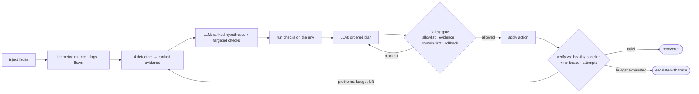
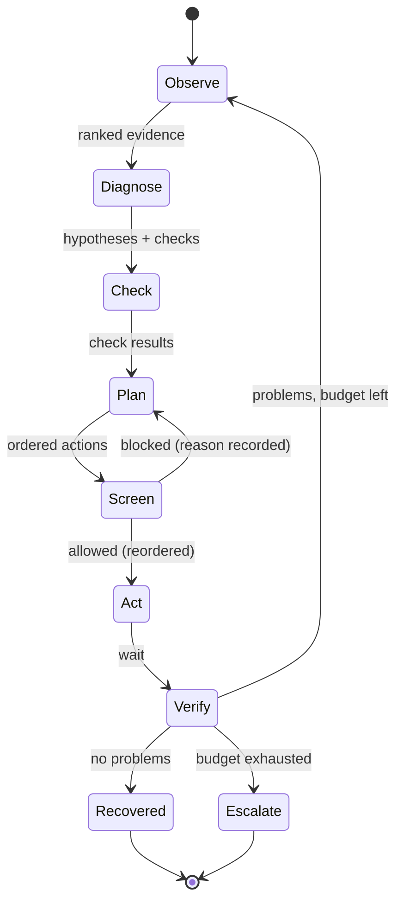

# Sentinel-RX — security-aware agentic recovery of a failing system

[](https://github.com/AbdulAlharbi/sentinel-rx/actions/workflows/ci.yml)


> Developed and evaluated fully offline on one laptop (MacBook Air, no GPU, no cloud). CI runs
> ruff, the tests, a replay smoke run and regression floors on every push; GitHub Pages serves
> `site/` through `.github/workflows/pages.yml`.

Sentinel-RX is an agent that **identifies, diagnoses, recovers and verifies the recovery** of a
failing enterprise system — and a reproducible benchmark that measures it on incidents it has
never seen. Four cheap deterministic detectors (metric anomalies, log templates, a
dependency-aware root-cause ranker, and a RandomForest **beacon detector**) turn thousands of
metrics, log lines and network flows into a short ranked evidence list; a local 7B model
(qwen2.5:7b via Ollama) reasons over that list, requests targeted checks and plans an ordered
remediation; a **safety layer** enforces an allowlist, *contain-before-restart* for compromised
hosts, dry-run and transactional rollback; and a **verification gate** lets the agent say
"recovered" only when post-action telemetry matches the pre-incident baseline and no beacon
attempt remains. It targets the gaps the literature review identifies — concurrent faults,
security incidents hidden inside ops incidents, false "recovered" claims, agent cost, and
robustness to unseen/degraded input — and runs 100 % locally and free (no Docker, no cloud).



## Headline results (held-out)

20 held-out scenarios (fault combinations and seeds never present in dev; 1–3 concurrent
faults, security faults hidden inside ops faults) × 3 seeds = 60 runs per configuration,
qwen2.5:7b, mean with 95 % bootstrap CI. Generated by `make report` into `results/summary.md`.

| config | top-1 | top-3 | per-fault recall | recovered | false recovery | harmful / run | unnecessary / run | action precision | isolate-before-restart | LLM calls | tokens | n |
|---|---|---|---|---|---|---|---|---|---|---|---|---|
| agent | 92% [83, 98] | 95% [88, 100] | 82% [74, 89] | 100% [100, 100] | 0% [0, 0] | 0.00 [0.00, 0.00] | 1.18 [0.68, 1.78] | 81% [74, 88] | 100% [100, 100] | 4.6 | 6103 | 60 |
| runbook | 87% [78, 95] | 95% [88, 100] | 81% [74, 87] | 45% [32, 58] | 5% [0, 12] | 0.00 [0.00, 0.00] | 0.67 [0.52, 0.82] | 74% [68, 80] | 100% [100, 100] | 0.0 | 0 | 60 |
| single_shot | 63% [50, 75] | 78% [67, 88] | 50% [41, 59] | 30% [20, 42] | 70% [58, 80] | 0.27 [0.15, 0.38] | 1.88 [1.70, 2.07] | 37% [30, 43] | 38% [19, 57] | 1.0 | 2421 | 60 |
| llm_only | 35% [15, 55] | 60% [40, 80] | 44% [28, 61] | 35% [15, 55] | 15% [0, 30] | 0.55 [0.15, 1.05] | 8.60 [6.00, 11.15] | 25% [13, 39] | 43% [14, 86] | 18.4 | 35018 | 20 |
| do_nothing | 0% [0, 0] | 0% [0, 0] | 0% [0, 0] | 0% [0, 0] | 0% [0, 0] | 0.00 [0.00, 0.00] | 0.00 [0.00, 0.00] | n/a | 100% [100, 100] | 0.0 | 0 | 60 |
| random | 0% [0, 0] | 0% [0, 0] | 0% [0, 0] | 0% [0, 0] | 10% [3, 18] | 3.45 [2.92, 3.98] | 13.13 [12.35, 13.93] | 5% [4, 7] | 90% [76, 100] | 0.0 | 0 | 60 |

Model: qwen2.5:7b; files: 20261030T031126Z_heldout_agent.json, 20261030T031121Z_heldout_runbook.json, 20261030T041454Z_heldout_single_shot.json, 20261030T051451Z_heldout_llm_only.json, 20261030T031121Z_heldout_do_nothing.json, 20261030T031121Z_heldout_random.json

**By number of concurrent faults (recovered / top-1):**

| config | 1 fault | 2 faults | 3 faults |
|---|---|---|---|
| agent | 100% / 75% | 100% / 93% | 100% / 100% |
| runbook | 75% / 50% | 37% / 93% | 38% / 100% |
| single_shot | 75% / 50% | 33% / 67% | 0% / 67% |
| llm_only | 100% / 50% | 22% / 33% | 14% / 29% |
| do_nothing | 0% / 0% | 0% / 0% | 0% / 0% |
| random | 0% / 0% | 0% / 0% | 0% / 0% |

| | |
|---|---|
|  |  |
|  |  |
|  |  |

**Reading the table.** On held-out incidents the hybrid agent recovers every run (60/60) without a
single false "recovered" claim or harmful action, with 4.6 LLM calls and ~6 100 tokens per
incident. The runbook diagnoses almost as well (its thresholds are the fault definitions) but
recovers only 45 %: it cannot order containment before a restart, repeats itself, and treats
symptoms as causes. The single-shot LLM claims success in 70 % of runs while recovering 30 %, and
restarts beaconing hosts before containment (0.27 harmful/run). The LLM-only loop — same loop,
raw telemetry instead of detectors — recovers 35 %, makes 0.55 harmful actions per run and costs
5.7× the tokens: the detectors, not the loop, carry the result. The sanity floors recover
nothing (random: 3.45 harmful actions/run). Top-1 on single-fault incidents (75 %) is the weak
spot: type confusions whose fix coincides (latency on the cache labelled `cache_failure`, fixed
by a restart), scored as misses on purpose.

## The challenge, line by line

The challenge asks for an agent that can *investigate potential problems, analyze available
information such as logs and system metrics, identify likely causes, recommend or carry out
corrective actions, and verify that the system has recovered successfully*, in environments where
*multiple issues occur at once*. Where each clause is met, and the number that proves it:

| Challenge clause | Where it is met | Held-out evidence (20 scenarios × 3 seeds) |
|---|---|---|
| investigate potential problems | the Observe step runs four detectors over the last 900 s and the LLM requests up to 3 targeted checks per iteration (`agent/loop.py`, `_run_check`) | 2.2 iterations and 4.6 LLM calls per incident |
| analyze logs and system metrics | robust z-scores on 8 metrics per service, log-template signatures, flow-timing features for beacons (`agent/detectors/`) | detector-only runbook already reaches top-1 87% |
| identify likely causes | ranked hypotheses with confidence, dependency ranker separates cause from symptom (`agent/detectors/ranker.py`) | top-1 92% [83, 98], per-fault recall 82% |
| recommend or carry out corrective actions | ordered plan from an 8-action allowlist, executed through the safety layer; `--dry-run` recommends only (`agent/safety.py`) | recovered 100%, harmful actions 0.00/run, action precision 81% |
| verify that the system has recovered | verification gate compares post-action telemetry with the healthy baseline; a claim is scored against hidden ground truth (`agent/detectors/evidence.py::verify`) | false "recovered" 0% (single-shot LLM: 70%) |
| multiple issues at once | 1–3 concurrent faults per scenario, including a security compromise inside an ops incident | recovered 100% at 1, 2 and 3 faults; runbook 75/37/38% |
| free choice of environment | a deterministic simulator for the benchmark and five real local processes for the demo, behind one `Env` interface | same agent, byte-identical, on both |

## Requirements → design decisions

| Requirement | Design decision | Why | Proof |
|---|---|---|---|
| Identify | Observe step runs four deterministic detectors and hands the LLM a per-service ranked evidence list, never raw telemetry | 4 000 flows + 2 000 log lines do not fit a 7B context; ranked evidence does (~600 tokens) | `agent/detectors/evidence.py:71` (`to_prompt`), `tests/test_detectors.py::test_evidence_is_compact_and_quiet_after_recovery` |
| Diagnose | LLM returns ranked hypotheses + up to 3 targeted checks (strict JSON, one auto-repair); dependency ranker discounts symptoms explained by an unhealthy dependency | separates cause from victim, the main failure of threshold runbooks | `agent/detectors/ranker.py:38`, `agent/loop.py:75` (`_json_call`), `tests/test_detectors.py::test_ranker_prefers_downstream_cause_over_upstream_symptom` |
| Recover | Ordered plan from an 8-action allowlist, executed through the safety layer; history of applied actions and remaining problems fed back; repeated plans are re-asked once | small models repeat themselves; the guard halved LLM calls (docs/RESULTS.md v0→v1) | `agent/loop.py` (repeated-plan guard), `agent/prompts.py` |
| Verify | Recovery may only be claimed when `Evidence.problems()` is empty: post-action telemetry vs the remembered healthy baseline, no beacon attempt, every service up | gap G3: an agent must not grade its own work | `agent/detectors/evidence.py:185` (`verify`), `:134` (`problems`), `tests/test_detectors.py::test_verify_fails_while_fault_persists` |
| Concurrent faults | Scenarios carry 1–3 faults on distinct services; hypotheses accumulate across iterations; scorer reports per-fault recall | gap G1 | `scenarios/generate.py:88`, `bench/score.py:35`, `tests/test_agent.py::test_loop_recovers_three_faults_with_safety_reordering` |
| Security-aware ordering | Beacon detector (timing features + destination knowledge); safety layer reorders containment first and blocks a restart of a beaconing host until contained; restart-before-containment is harmful and re-infects | gap G2 | `agent/detectors/beacon.py:114`, `agent/safety.py:49` (`screen`), `faults/security.py:50`, `tests/test_sim.py::test_restart_before_containment_is_harmful_and_reinfects` |
| No false recovery claims | Contained implants keep emitting *blocked* attempts; beacon pairs flagged during the incident are "known" and any un-blocked flow on them fails verification | otherwise "contained" and "eradicated" are indistinguishable | `faults/security.py` (`blocked=True` flows), `agent/detectors/evidence.py:182`, `tests/test_detectors.py::test_verify_is_not_fooled_by_containment_alone` |
| Safety allowlist + rollback | Allowlist, evidence-gated containment, dry-run, health measured before/after each action with undo on a drop > 0.15 | collateral damage is a real failure mode (random baseline: 3.45 harmful actions/run) | `agent/safety.py:22` (`REGRESSION_DROP`), `:104` (`execute`), `env/base.py:61` (`undo_action`), `tests/test_agent.py::test_safety_rolls_back_regressions`, `::test_safety_blocks_restart_before_containment_and_isolation_without_evidence` |
| Held-out discipline | Disjoint combinations, type multisets and seeds; runner refuses non-dev splits without `--final` and logs every held-out run | criterion 1 | `scenarios/generate.py`, `bench/runner.py:201` (`guard_heldout`), `results/heldout_runs.log`, `tests/test_scenarios.py::test_heldout_is_disjoint_from_dev`, `tests/test_runner.py::test_heldout_requires_final` |
| Reproducibility (replay cache) | Every LLM call cached by hash(model, system, prompt, options) in `cache/` (committed); `--replay` forbids live calls | the benchmark re-runs with no LLM; CI runs `make smoke` from the cache | `agent/llm.py:97` (`complete`), `:26` (`ReplayMissError`), `tests/test_agent.py::test_llm_cache_record_and_replay` |
| Cost awareness | Two LLM calls per iteration, compact prompts, tokens + latency logged per call and per run | gap G4 | `agent/llm.py` (`Usage`), cost column in every results file, `docs/figures/cost-vs-accuracy.png` |

## Mapping to the judging criteria

| Criterion | Evidence (details in `docs/JUDGING.md`) |
|---|---|
| 1. Task performance | Held-out table above; `make bench-heldout`; split guard `bench/runner.py:201`; `results/heldout_runs.log` |
| 2. Robustness & adaptation | Robustness table below; `env/perturb.py`; smaller-model run; same agent on `env/sim` and `env/live` (`make demo-live`, `tests/test_live_env.py`) |
| 3. Evaluation & iteration | `docs/RESULTS.md` (v0→v3 with before/after numbers and a scorer audit); baselines incl. do_nothing/random floors; ablations; 108 tests; CI with replay smoke + regression floors (`bench/smoke_gate.py`) |
| 4. Technical judgment & creativity | Hybrid vs `llm_only`; beacon detector + contain-before-restart; verification gate; transactional rollback; `docs/DESIGN.md` |
| 5. Engineering quality | `Makefile` targets; pinned deps; ruff-clean typed modules < 400 lines; replay reproducibility; one branch per phase merged with `--no-ff` |
| 6. Communication | This README, `site/` (leaderboard, charts, incident replay viewer), `docs/literature_review.pdf` |

## Quick start

```bash
make setup          # venv, pinned deps, scenarios, beacon detector training (~1 min)
make test           # 108 tests, no LLM needed
make smoke          # 5 dev scenarios from the replay cache, no LLM needed (<60 s)
make demo-live      # 5 real local processes + 3 concurrent faults + the agent (needs Ollama + qwen2.5:7b)
make all-final      # held-out, perturbations, ablations, report (needs Ollama; several hours)
```

### What a run looks like

`make smoke` (replay cache, no LLM; recorded output):

```text
.venv/bin/python -m bench.runner --split dev --config agent --limit 5 --seeds 1 --replay --tag smoke
[agent] 1/5 dev_1f_00 s0 top1=1 rec=1 false_rec=0 harm=0 llm=2
[agent] 2/5 dev_1f_01 s0 top1=1 rec=1 false_rec=0 harm=0 llm=2
[agent] 3/5 dev_1f_02 s0 top1=1 rec=1 false_rec=0 harm=0 llm=2
[agent] 4/5 dev_1f_03 s0 top1=0 rec=1 false_rec=0 harm=0 llm=2
[agent] 5/5 dev_1f_04 s0 top1=1 rec=1 false_rec=0 harm=0 llm=2
== dev / agent: n=5 top1=0.80 recall=0.80 recovered=1.00 false_rec=0.00 harmful=0.00 -> 20261030T034744Z_dev_agent_smoke.json
smoke gate ok (20261030T034744Z_dev_agent_smoke.json): recovered=1.00, top1=0.80, false_recovery=0.00, harmful_actions=0.00
```

`make demo-live` (real processes, live qwen2.5:7b; abridged from `results/demo_live_console.txt`):

```text
[21:57:42] Starting 5 real local services (gateway, api, db, cache, worker) + a C2 sinkhole ...
[21:57:42] Services up on ports {'gateway': 55783, 'api': 55784, 'db': 55785, 'cache': 55786, 'worker': 55787}. Generating normal traffic for 35s (baseline).
[21:58:17] Baseline health = 1.00
[21:58:17] INJECTING three concurrent faults:
[21:58:17]   1. memory_leak      -> api     (heap grows ~6 MB/s, handlers slow down)
[21:58:17]   2. db_conn_exhaustion -> db    (idle connections hold the whole pool)
[21:58:17]   3. c2_beacon        -> worker  (phones home every ~4s +/-20% to 203.0.113.47, a local sinkhole)
[21:59:02] Incident in progress: health = 0.10
[21:59:03] Detector view (what the LLM will see):
   ... (detector JSON omitted; see results/demo_live_console.txt) ...
[21:59:03] Running Sentinel-RX (model=qwen2.5:7b) ...
[22:05:13] --- iteration 0 ---
[22:05:13] hypotheses: api:db_conn_exhaustion(0.90), api:latency_injection(0.70), worker:memory_leak(0.60)
[22:05:13] checks: logs(api,'db query failed: too many connections'), metrics(api,), metrics(worker,)
[22:05:13] plan: scale_connections(api), restart_service(worker), restart_service(api)
[22:05:13]   safety: scale_connections(api) -> applied  scale_connections applied
[22:05:13]   safety: restart_service(worker) -> blocked beacon hypothesis open: contain (block_egress/isolate) before restart 
[22:05:13]   safety: restart_service(api) -> applied  restarted clean
[22:05:13] verify after 18s: ['health 0.10 < 0.9', 'worker.queue_depth up (0 -> 311)', 'db.conn_count up (0 -> 8)', 'gateway.error_rate up (0 -> 1)', 'api.error_rate up (0 -> 1)', 'api logs: db query failed: too many connections x5', 'beacon worker->203.0.113.47 p=0.82 blocked=0%']
[22:05:13] --- iteration 1 ---
[22:05:13] hypotheses: db:db_conn_exhaustion(0.90), api:db_conn_exhaustion(0.80)
[22:05:13] checks: metrics(api,), metrics(db,), logs(api,db query failed: too many connections)
[22:05:13] plan: scale_connections(db), restart_service(api)
[22:05:13]   safety: scale_connections(db) -> applied  scale_connections applied
[22:05:13]   safety: restart_service(api) -> applied  restarted clean
[22:05:13] verify after 19s: ['worker.queue_depth up (0 -> 431)', 'beacon worker->203.0.113.47 p=0.88 blocked=0%']
[22:05:13] --- iteration 2 ---
[22:05:13] hypotheses: worker:latency_injection(0.95)
[22:05:13] checks: logs(worker,INFO '/get?k=order:<*> <*> <*>ms' x2), metrics(db,), flows(worker,)
[22:05:13] plan: block_egress(worker), restart_service(worker)
[22:05:13]   safety: block_egress(worker) -> applied  block_egress applied
[22:05:13]   safety: restart_service(worker) -> applied  restarted clean
[22:05:13] verify after 15s: RECOVERED
[22:05:13] Agent claims recovered = True; escalated = False; LLM calls = 6, tokens = 9058
[22:05:13] GROUND TRUTH from the live system: active faults = {'gateway': [], 'api': [], 'db': [], 'cache': [], 'worker': []}; restart-before-containment = 0; sinkhole hits = {'gate': 97, 'updates': 42}
[22:05:13] Final health = 1.00
[22:05:13] Trace written to results/demo_live_trace.json
```

The model first missed the beacon; the verification gate refused "recovered" twice
(`beacon worker->203.0.113.47`), and the third iteration contained the worker *before*
restarting it. The live system's own ground truth confirms every fault gone and no
restart-before-containment.

```mermaid
sequenceDiagram
  participant Env as System (api leak + db exhaustion + worker beacon)
  participant Det as Detectors
  participant LLM as LLM (qwen2.5:7b)
  participant Safe as Safety layer
  participant Ver as Verifier
  Det->>Env: metrics / logs / flows (900 s window)
  Det->>LLM: evidence: db.conn_count↑ + "too many connections", api.mem↑ + GC pauses, beacon worker→203.0.113.47 p=0.98
  LLM->>Env: checks: logs(db, "too many"), flows(worker)
  LLM->>Safe: plan: restart worker, restart api, scale db, block_egress worker
  Safe->>Safe: reorder: containment first; restart(worker) allowed only after block_egress
  Safe->>Env: block_egress(worker) → restart_service(worker) → restart_service(api) → scale_connections(db)
  Ver->>Env: wait 4.5 × beacon interval; compare with healthy baseline; scan flows for (worker, 203.0.113.47)
  Ver-->>LLM: quiet → "recovered" (claim is then checked against hidden ground truth by the scorer)
```

## Architecture



| Module | Responsibility | Key functions |
|---|---|---|
| `env/base.py` | Env interface + observable health | `Env`, `service_health`, `combine_health` |
| `env/sim/` | Deterministic simulator: world, propagation, telemetry, actions, hidden ground truth | `World.compute_metrics`, `SimEnv.apply_action`, `SimEnv.gt_recovered` |
| `env/live/` | Five real local processes, fault injection, supervision, sinkhole, demo | `service.py`, `faults.py:inject/act`, `LiveEnv.apply_action`, `demo.py` |
| `env/perturb.py` | Observation-layer perturbations | `NoisyLogs`, `MissingMetrics`, `RenamedServices`, `TimestampJitter` |
| `faults/` | 9 known fault types + held-out `dns_failure`; symptoms, correct sequences, harmful actions | `Fault.tick/on_action`, `C2Beacon`, `registry.py` |
| `scenarios/` | YAML schema + generator with split guards | `generate.py`, `schema.py` |
| `agent/detectors/` | Metric z-scores, log templates, dependency ranker, beacon RF, evidence builder/verifier | `detect_metric_anomalies`, `detect_log_signatures`, `rank_services`, `BeaconDetector`, `EvidenceBuilder.verify` |
| `agent/loop.py` | MAPE-K loop with step budget | `SentinelAgent.run` |
| `agent/safety.py` | Allowlist, evidence gate, ordering, dry-run, rollback | `SafetyLayer.screen/execute` |
| `agent/llm.py`, `agent/prompts.py`, `agent/schema.py` | Ollama client with record/replay cache; prompts; JSON validation | `LLMClient.complete`, `validate` |
| `agent/runbook.py`, `agent/baselines.py`, `agent/raw.py` | Baselines: runbook, single_shot, do_nothing, random; raw telemetry summary for LLM-only variants | |
| `bench/` | Scorer, bootstrap aggregation, runner with held-out guard, rescore, report, smoke gate | `score_run`, `aggregate`, `run_split`, `report.main` |

**Environment interface** (`env/base.py:28`): `list_services`, `get_topology`, `get_status`,
`get_metrics(window)`, `get_logs(service, window, grep)`, `get_flows(window)`,
`apply_action`, `undo_action`, `wait`, `reset`, `snapshot`, `now`, `external_allowlist`,
`health_score`. The agent sees nothing else; the runner reaches hidden ground truth through
`SimEnv.gt_*` only.

**Detectors.** Metric anomalies: robust z-score (median/MAD) of the recent window vs the
first 30 % of the window, or vs a stored baseline in verification; `None` values ignored.
Log signatures: numbers/ids → `<*>`, new or surging templates weighted by severity.
Dependency ranker: `score = max(intrinsic, propagated − 0.7 · worst dependency)` where
mem/disk/conn/cpu/status-down are intrinsic and latency/errors/queue propagate.
Beacon: per (src, dst) inter-arrival CV and MAD ratio, fraction within ±30 % of the median
interval, spectral concentration, autocorrelation at the median lag, sub-window stability,
byte-size CV, plus dst-external / dst-allow-listed / src-is-monitor; RandomForest (200 trees)
trained on an independent synthetic set (`agent/detectors/beacon_train.py:144`), evaluated
on a disjoint synthetic test set and on the simulator's dev scenarios
(`models/beacon_metrics.json`: precision 0.989, recall 0.978, AP 0.999 on n=2000; health-check FP rate 0.000, update-poll FP rate 0.000; dev scenarios 5 found / 0 false positives). Allow-listed and internal destinations need
p ≥ 0.75; in verification new pairs need p ≥ 0.75 / 0.95 while known pairs fail on any
un-blocked flow.

**LLM backend.** `agent/llm.py`: Ollama `/api/generate`, JSON mode, temperature 0, seed 0,
`num_predict` 500; every call cached under `cache/<model>/<sha256>.json` with tokens and
latency; `--replay` raises on a miss. Smaller-model run uses `qwen2.5:1.5b` unchanged.

## Evaluation methodology

* **Scenario generation** (`scenarios/generate.py`): dev 30 (10/12/8 for 1/2/3 faults),
  held-out 20 (4/9/7) with disjoint (type@target) combinations, disjoint type multisets for
  multi-fault scenarios, and a disjoint seed range; starts between ticks 40–65, parameters
  randomised. `dns_failure` appears only in `perturbations/unseen_fault` (8 scenarios).
* **Enforcement**: `tests/test_scenarios.py` checks the committed YAML; `bench/runner.py`
  refuses non-dev splits without `--final` and logs every held-out run.
* **Perturbations** (`env/perturb.py`): noisy logs (30 % dropped, 80 % noise incl. spurious
  ERRORs), missing metrics (a third of (service, metric) series), renamed services, ±2 s
  timestamp jitter, unseen fault type; plus a smaller LLM.
* **Baselines**: `runbook` (static rules, with a naive "unknown egress → block" rule so it is not
  strawmanned on security), `single_shot` (one LLM call on a raw telemetry summary, no loop,
  claims success), `llm_only` (the full loop with raw telemetry instead of detectors, LLM-judged
  verification), `do_nothing` and `random` (sanity floors).
* **Ablations**: `no_verify`, `no_loop`, `no_beacon`, `no_safety`.
* **Metrics** (`bench/score.py:35`): top-1/top-3 root cause (service + type), per-fault recall
  and precision, recovered (hidden ground truth: every fault resolved, every service up,
  health ≥ 0.9 for 2 ticks), false recovery (claimed ∧ ¬recovered), harmful actions
  (restart of a beaconing host before containment; containment of an uncompromised host),
  unnecessary actions (applied − effective), action precision (effective / applied),
  rolled-back actions, isolated-before-restart, steps, time to recovery, LLM calls, tokens,
  wall-clock. The scorer was audited mid-development (docs/RESULTS.md "Scorer audit").
* **Seeds and CIs**: held-out 3 seed offsets per scenario; perturbations/ablations 1 seed;
  95 % percentile bootstrap over (scenario × seed) runs (`bench/aggregate.py:29`).

## Robustness and ablation results

**Robustness (agent, held-out variants, 1 seed):**

| perturbation | top-1 | recovered | false recovery | harmful / run | change in recovered (pts) | n |
|---|---|---|---|---|---|---|
| noisy_logs | 95% | 100% | 0% | 0.00 | -0 | 20 |
| missing_metrics | 90% | 95% | 0% | 0.00 | -5 | 20 |
| renamed_services | 90% | 100% | 0% | 0.00 | -0 | 20 |
| timestamp_jitter | 90% | 100% | 0% | 0.00 | -0 | 20 |
| unseen_fault | 62% | 100% | 0% | 0.00 | -0 | 8 |
| smaller LLM (qwen2.5:1.5b) | 40% | 50% | 0% | 0.00 | -50 | 20 |

**Ablations (held-out, 1 seed; delta vs full agent):**

| ablation | top-1 | recovered | false recovery | harmful / run | unnecessary / run | LLM calls | n |
|---|---|---|---|---|---|---|---|
| no_verify | 80% (-12) | 20% (-80) | 80% (+80) | 0.00 (+0.00) | 0.60 (-0.58) | 2.0 | 20 |
| no_loop | 80% (-12) | 20% (-80) | 0% (+0) | 0.00 (+0.00) | 0.60 (-0.58) | 2.0 | 20 |
| no_beacon | 85% (-7) | 50% (-50) | 35% (+35) | 0.05 (+0.05) | 2.75 (+1.57) | 6.2 | 20 |
| no_safety | 90% (-2) | 100% (+0) | 0% (+0) | 0.60 (+0.60) | 2.05 (+0.87) | 4.8 | 20 |

**Interpretation.** Recovery is unchanged (95–100 %) under noisy logs, missing metrics,
renamed services and timestamp jitter: the detectors are relative (recent vs baseline) and
scale-invariant, and the prompt never hard-codes service names. On the unseen fault type the
agent still recovers 8/8 (rollback or restart on the right service) but names the type `other`,
so top-1 falls to 62 %. The 1.5B model halves recovery (50 %) yet keeps 0 % false claims and 0
harmful actions, because those guarantees come from the verifier and the safety layer, not from
the model. The ablations say which component earns its keep: without verification 80 % of runs
end in a false claim; without the loop only one plan is ever tried (20 % recovered); without the
beacon detector half the runs fail and 35 % claim falsely (the LLM alone does not see the beacon
in raw flow counts); without the safety layer recovery is unchanged but 0.60 harmful actions per
run appear — exactly the restart-before-containment the layer exists to prevent. One-seed
caveat: ablation and perturbation deltas are directional (20 runs each; `docs/LIMITATIONS.md`).

## Testing

`pytest -q` (108 tests, no LLM required; recorded output):

```text
........................................................................ [ 66%]
....................................                                     [100%]
108 passed in 66.79s (0:01:06)
```

| file | covers |
|---|---|
| `tests/test_sim.py` | determinism, speed, propagation, allowlist, wrong fixes, reinfection, rebuild semantics |
| `tests/test_faults.py` | each fault's symptoms, every correct sequence recovers, persistence without remediation, wrong target/action never resolves |
| `tests/test_scenarios.py` | generator determinism, committed YAML matches, dev/held-out disjointness, unseen-type isolation |
| `tests/test_detectors.py` | templates, metric anomalies (incl. missing values), ranker, beacon vs health checks/update polls, scale invariance, verification gate |
| `tests/test_agent.py` | loop with a scripted LLM, safety decisions, rollback, dry-run, schema validator, cache record/replay, config factory |
| `tests/test_score.py` | hand-made traces: perfect run, false recovery, harmful containment, action precision, bootstrap CIs |
| `tests/test_runner.py` | held-out guard, perturbation wrappers, end-to-end runbook/do_nothing/random runs |
| `tests/test_live_env.py` | real processes: beacon detected and contained, restart-without-containment re-infects, cleanup |

CI (`.github/workflows/ci.yml`): ruff + `ruff format --check`, pytest, `make smoke`
(replay), `bench/smoke_gate.py` regression floors (recovered ≥ 0.8, top-1 ≥ 0.8, false
recovery = 0, harmful = 0 on the smoke scenarios).

## Extending

**Add a fault** — subclass `faults.base.Fault`, register it:

```python
class DnsFailure(Fault):
    type = "dns_failure"

    def correct_sequences(self):
        return [["rollback_config(api)"], ["restart_service(api)"]]

    def tick(self, world, tick):  # mutate world.effects[self.target], emit logs/flows
        if self.is_active(tick):
            world.effects[self.target].error_add += 0.7

    def on_action(self, action, world, tick):
        if action.target == self.target and action.name in ("rollback_config", "restart_service"):
            self.resolve(tick, "resolver restored")
            return "name resolution restored"


# faults/registry.py: add to FAULT_CLASSES and VALID_TARGETS
```

**Add a detector** — return anything with `.to_dict()`, add it to `EvidenceBuilder._assemble`
and to `Evidence.to_prompt()`; if it should gate verification, add a line to
`Evidence.problems()`.

**Add a scenario** — drop a YAML file in `scenarios/dev/`:

```yaml
id: dev_custom_01
split: dev
seed: 4242
faults:
  - {type: memory_leak, target: api, start: 50, params: {rate: 1.5}}
  - {type: c2_beacon, target: worker, start: 45, params: {interval: 40, jitter: 0.2}}
```

## Project layout

```text
agent/            loop, safety layer, LLM client + cache, prompts, baselines, detectors/
bench/            scorer, aggregation, runner (held-out guard), rescore, report, smoke gate
cache/            committed LLM responses (record/replay)
docs/             DESIGN, RESULTS (iteration log), LIMITATIONS, JUDGING, figures/, literature_review.pdf, technical_report/ (brief + full report, LaTeX + PDF)
env/              Env interface, sim/ (simulator), live/ (real processes), perturb.py
faults/           fault library (ops + security + held-out dns_failure)
models/           trained beacon RandomForest + its metrics
results/          results JSON, traces/, summary.md, heldout_runs.log, demo console + trace
scenarios/        schema, generator, dev/ heldout/ perturbations/ YAML
site/             static GitHub Pages site in the HUMAIN/PIF palette: impact, Judging Criteria map, results, figures, replay viewer, reports
tests/            108 tests
```

## Verified / known gaps

**Verified (actually run in this repository):** everything in `results/` — dev iterations v0–v3
(1 seed), audit baselines (3 seeds), held-out runs for every configuration in the headline
table (3 seeds; `llm_only` 1 seed), ablations and perturbations (1 seed), the smaller-model
run, one recorded `make demo-live`, `make smoke` from the cache, the full test suite, ruff.

**Known gaps:**
* Everything was developed and evaluated on one laptop; CI and Pages run from the committed
  cache and artefacts, so a CI run never calls a model.
* `llm_only`, perturbations, ablations and the smaller-model run use one seed (`docs/LIMITATIONS.md`).
* `llm_only`'s verification is LLM-judged; its false-recovery rate reflects that design.
* Live-environment numbers are not benchmark numbers (non-deterministic timing; no cache).
* Re-recording with Ollama is not bit-reproducible; the committed cache is.

## Limitations, taking it to production, roadmap

See `docs/LIMITATIONS.md` for the full list. Production path: replace the simulator's flow
records with NetFlow/Zeek features (the detector is scale-invariant), map the eight allowlisted
actions to real runbook automations behind the same safety layer, require human approval for
irreversible actions, retrain the beacon model on real captures, and keep the verification gate
as the only path to "resolved". Roadmap: lateral movement and exfiltration scenarios,
multi-cluster topology, learned (not hand-written) fault signatures, stronger local models.

## Links

* Technical brief (6 pages): [`docs/technical_report/sentinel_rx_brief.pdf`](docs/technical_report/sentinel_rx_brief.pdf) · full technical report (27 pages): [`docs/technical_report/sentinel_rx_technical_report.pdf`](docs/technical_report/sentinel_rx_technical_report.pdf)
* Literature review: [`docs/literature_review.pdf`](docs/literature_review.pdf)
* Site: https://AbdulAlharbi.github.io/sentinel-rx/ (GitHub Pages from `site/`), or locally: `python -m http.server -d site 8000`
* Design: [`docs/DESIGN.md`](docs/DESIGN.md) · Iteration log: [`docs/RESULTS.md`](docs/RESULTS.md) · Judging map: [`docs/JUDGING.md`](docs/JUDGING.md)

License: MIT.
